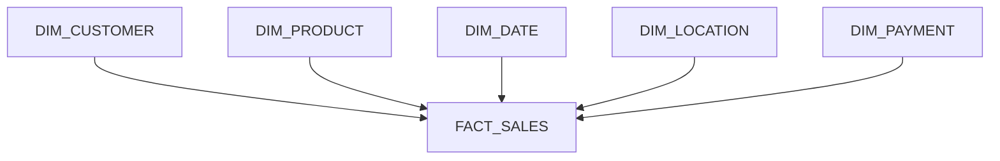

# E-Commerce Sales Analytics Data Warehouse Using Snowflake


## 1. Project Overview

This is my first hands-on Data Warehousing project, built using Snowflake and SQL.

The main goal is to develop an E-Commerce Sales Data Warehouse using **Star Schema** to organize sales data and perform business analysis.

The project focuses on understanding how companies store, manage, transform, and analyze business data.

## 2. Business Problem

An e-commerce company receives orders from customers across different cities and sells products from multiple categories.

The company wants to understand its sales performance but needs properly organized data to generate useful reports.

This project aims to answer questions such as:

- Which products generate the highest revenue?
- Who are the top customers?
- Which city generates the most sales?
- Which month has the highest revenue?
- Which product category performs best?
- Which payment method is most popular?

## 3. Project Objectives

- Build a Data Warehouse using Snowflake.
- Understand and implement Star Schema.
- Create Fact and Dimension Tables.
- Practice SQL queries and JOIN operations.
- Load and validate sales data.
- Perform business analysis using SQL.
- Develop a foundation for ETL pipelines and reporting.

## 4. Technology Stack

| Technology | Purpose |
|---|---|
| Snowflake | Cloud Data Warehouse |
| SQL | Data querying and analysis |
| CSV | Planned source data format |
| Power BI | Planned business dashboard |

## 5. Star Schema Design

This project follows Star Schema, which contains one central Fact Table connected to five Dimension Tables.


### Database Structure

```text
ECOMMERCE_DB
│
└── ANALYTICS
    │
    ├── DIM_CUSTOMER
    ├── DIM_PRODUCT
    ├── DIM_DATE
    ├── DIM_LOCATION
    ├── DIM_PAYMENT
    │
    └── FACT_SALES
```

### Understanding the Tables

| Table | Description |
|---|---|
| DIM_CUSTOMER | Stores customer information |
| DIM_PRODUCT | Stores product details |
| DIM_DATE | Stores date, month, quarter and year |
| DIM_LOCATION | Stores city, state and country |
| DIM_PAYMENT | Stores payment methods and status |
| FACT_SALES | Stores sales transactions and amounts |

### Star Schema Architecture



## 6. Understanding Fact and Dimension Tables

**Fact Table:**

Stores measurable business information such as quantity, unit price, discount and total sales amount.

**Dimension Tables:**

Store descriptive information such as customer name, product category, date, city and payment method.

### Fact Table Grain

One row in `FACT_SALES` represents **one product line item within one customer order**.

For example, if a customer buys a laptop and a mouse in one order, two separate records are stored.

## 7. Important Database Concepts

| Concept | Simple Explanation |
|---|---|
| Primary Key | Uniquely identifies a record |
| Foreign Key | Connects related tables |
| Surrogate Key | Warehouse-generated ID |
| Business Key | Original ID from the business system |
| JOIN | Combines data from multiple tables |
| ETL | Extract, Transform and Load |

## 8. Project Scope

The project is divided into these stages:

1. Snowflake environment setup.
2. Star Schema database design.
3. Fact and Dimension Table creation.
4. Data insertion and validation.
5. ETL pipeline development.
6. SQL-based business analysis.
7. Power BI dashboard development.

## 9. Project Status

**Currently Working On:** Snowflake Table Implementation and Fact Table Data Loading.

The database environment and Star Schema structure have been developed. The `FACT_SALES` table has been created, and its sample data-loading process is being verified.

Further work will include ETL pipelines, data validation, business analysis and dashboard development.

---

**Project Type:** Data Warehousing / Data Engineering

**Platform:** Snowflake

**Language:** SQL

**Data Modelling:** Star Schema

## 10. Snowflake Environment Setup

First, I configured my Snowflake environment for the E-Commerce Data Warehouse project.

### Created Virtual Warehouse

**Warehouse Name:** `ECOMMERCE_WH`

```sql
CREATE WAREHOUSE IF NOT EXISTS ECOMMERCE_WH
WITH
    WAREHOUSE_SIZE = 'XSMALL'
    AUTO_SUSPEND = 60
    AUTO_RESUME = TRUE
    INITIALLY_SUSPENDED = TRUE;
```

**Why did I use these settings?**

- XSMALL: Suitable for our initial small dataset.
- AUTO_SUSPEND: Automatically stops the warehouse after inactivity.
- AUTO_RESUME: Automatically starts the warehouse when required.

### Created Database and Schema

```sql
CREATE DATABASE IF NOT EXISTS ECOMMERCE_DB;

CREATE SCHEMA IF NOT EXISTS ECOMMERCE_DB.ANALYTICS;
```

### Selected the Working Environment

```sql
USE WAREHOUSE ECOMMERCE_WH;

USE DATABASE ECOMMERCE_DB;

USE SCHEMA ANALYTICS;
```

## 11. Created Dimension Tables

I created five Dimension Tables to store descriptive business information.

| Table | Important Columns |
|---|---|
| DIM_CUSTOMER | CUSTOMER_KEY, CUSTOMER_ID, CUSTOMER_NAME, EMAIL, GENDER |
| DIM_PRODUCT | PRODUCT_KEY, PRODUCT_ID, PRODUCT_NAME, CATEGORY, BRAND, UNIT_PRICE |
| DIM_DATE | DATE_KEY, FULL_DATE, DAY_NAME, MONTH_NAME, QUARTER_NUMBER, YEAR_NUMBER |
| DIM_LOCATION | LOCATION_KEY, LOCATION_ID, CITY, STATE, REGION, COUNTRY |
| DIM_PAYMENT | PAYMENT_KEY, PAYMENT_ID, PAYMENT_METHOD, PAYMENT_STATUS, PAYMENT_TYPE |

### Important Concepts Learned

**IDENTITY(1,1)**

Automatically generates Surrogate Keys.

Example:

```sql
CUSTOMER_KEY NUMBER(10,0) IDENTITY(1,1)
```

**PRIMARY KEY**

Identifies a record using a unique key.

**VARCHAR**

Stores text values such as names, categories and IDs.

**NUMBER(10,2)**

Stores numerical values with decimal places, such as product prices.

**TIMESTAMP_NTZ**

Stores date and time without a time-zone value.

## 12. Created the DIM_DATE Table

For the Date Dimension, I learned how to generate calendar dates automatically instead of inserting them manually.

I created dates from 1 January 2025 to 31 December 2026.

Total expected records: 730.

Important SQL functions learned:

| Function | Purpose |
|---|---|
| GENERATOR() | Generates rows |
| ROW_NUMBER() | Generates sequential row numbers |
| DATEADD() | Adds days to a date |
| DAY() | Returns the day number |
| MONTH() | Returns the month number |
| YEAR() | Returns the year |
| QUARTER() | Returns the quarter |
| TO_CHAR() | Converts values into formatted text |

### Example Date Generation Query

```sql
SELECT
    DATEADD(
        DAY,
        ROW_NUMBER() OVER (ORDER BY SEQ4()) - 1,
        '2025-01-01'::DATE
    ) AS CALENDAR_DATE

FROM TABLE(GENERATOR(ROWCOUNT => 730));
```

This query generates calendar dates automatically.

## 13. Created the FACT_SALES Table

After creating all five Dimension Tables, I designed the central Fact Table.

**Table Name:** `FACT_SALES`

Important columns:

| Column | Purpose |
|---|---|
| SALES_KEY | Unique sales record ID |
| ORDER_ID | Original customer order ID |
| ORDER_LINE_NUMBER | Product line number within an order |
| CUSTOMER_KEY | Customer reference |
| PRODUCT_KEY | Product reference |
| DATE_KEY | Date reference |
| LOCATION_KEY | Location reference |
| PAYMENT_KEY | Payment reference |
| QUANTITY | Purchased quantity |
| UNIT_PRICE | Selling price per unit |
| DISCOUNT_AMOUNT | Discount amount |
| TOTAL_AMOUNT | Final sales amount |

### Understanding Fact Table Grain

One row represents one product line item within a customer order.

For example, if one customer purchases two different products in the same order, two records are stored.

### Sales Amount Calculation

```sql
TOTAL_AMOUNT =
(QUANTITY * UNIT_PRICE) - DISCOUNT_AMOUNT;
```

Example:

- Quantity = 1
- Unit Price = 55,000
- Discount = 5,000
- Total Amount = 50,000

## 14. Loading Data into FACT_SALES

I practiced inserting sales records into the Fact Table using:

`INSERT INTO + SELECT + VALUES + JOIN`

The sample sales data contains Business IDs such as CUSTOMER_ID, PRODUCT_ID and PAYMENT_ID.

However, our Fact Table requires Surrogate Keys such as CUSTOMER_KEY, PRODUCT_KEY and PAYMENT_KEY.

To solve this, I used JOIN operations.

### Basic SQL Structure

```sql
INSERT INTO FACT_SALES (
    ORDER_ID,
    CUSTOMER_KEY,
    PRODUCT_KEY,
    DATE_KEY,
    LOCATION_KEY,
    PAYMENT_KEY,
    QUANTITY,
    TOTAL_AMOUNT
)

SELECT
    S.ORDER_ID,
    C.CUSTOMER_KEY,
    P.PRODUCT_KEY,
    D.DATE_KEY,
    L.LOCATION_KEY,
    PM.PAYMENT_KEY,
    S.QUANTITY,
    S.TOTAL_AMOUNT

FROM SOURCE_SALES S

JOIN DIM_CUSTOMER C
    ON S.CUSTOMER_ID = C.CUSTOMER_ID

JOIN DIM_PRODUCT P
    ON S.PRODUCT_ID = P.PRODUCT_ID

JOIN DIM_DATE D
    ON S.ORDER_DATE = D.FULL_DATE

JOIN DIM_LOCATION L
    ON S.LOCATION_ID = L.LOCATION_ID

JOIN DIM_PAYMENT PM
    ON S.PAYMENT_ID = PM.PAYMENT_ID

WHERE PM.PAYMENT_STATUS = 'SUCCESS';
```

**Note:** `SOURCE_SALES` represents a conceptual source table in this simplified example. In our hands-on exercise, I provided the sample source records using a `VALUES` clause and assigned them the alias `S`.

### Important Learning

- INSERT INTO specifies where data should be saved.
- SELECT specifies which data should be inserted.
- VALUES provides sample source records.
- JOIN finds matching records from Dimension Tables.
- WHERE filters records based on business conditions.

This approach helps convert Business IDs into warehouse-generated Surrogate Keys.

## 15. Data Validation

Data validation is an important part of Data Engineering.

After loading data, we need to check whether the records are correct.

### Check Total Records

```sql
SELECT COUNT(*) AS TOTAL_RECORDS
FROM FACT_SALES;
```

### Check Total Revenue

```sql
SELECT
    SUM(TOTAL_AMOUNT) AS TOTAL_REVENUE
FROM FACT_SALES;
```

### Find Duplicate Order Lines

```sql
SELECT
    ORDER_ID,
    ORDER_LINE_NUMBER,
    COUNT(*) AS RECORD_COUNT
FROM FACT_SALES
GROUP BY ORDER_ID, ORDER_LINE_NUMBER
HAVING COUNT(*) > 1;
```

### Validate Sales Amount

```sql
SELECT *
FROM FACT_SALES
WHERE TOTAL_AMOUNT <>
    (QUANTITY * UNIT_PRICE - DISCOUNT_AMOUNT);
```

### Verify Customer Relationships

```sql
SELECT F.*
FROM FACT_SALES F
LEFT JOIN DIM_CUSTOMER C
    ON F.CUSTOMER_KEY = C.CUSTOMER_KEY
WHERE C.CUSTOMER_KEY IS NULL;
```

These queries help identify duplicate records, incorrect calculations and missing dimension references.

## 16. Important SQL Concepts Practiced

| SQL Concept | Learning |
|---|---|
| CREATE TABLE | Creating database tables |
| INSERT INTO | Adding records |
| SELECT | Retrieving information |
| WHERE | Filtering records |
| GROUP BY | Grouping records |
| ORDER BY | Sorting results |
| COUNT() | Counting records |
| SUM() | Calculating totals |
| AVG() | Finding averages |
| JOIN | Combining related tables |
| PRIMARY KEY | Identifying records |
| FOREIGN KEY | Defining table relationships |
| IDENTITY | Generating automatic IDs |

## 17. Current Project Status

The Snowflake environment and database design have been developed, and the `FACT_SALES` table has been created.

During initial testing, the following query returned zero records:

```sql
SELECT *
FROM FACT_SALES;
```

This means the Fact Table data-loading process still needs verification.

The next step is to check the Dimension Table records, validate JOIN conditions, and successfully load the sample sales data.

### Next Development Steps

- Complete Fact Table data loading.
- Validate all six tables.
- Develop CSV-based ETL pipelines.
- Learn Snowflake Stages and File Formats.
- Use COPY INTO for loading CSV data.
- Perform business analysis using SQL.
- Develop a Power BI dashboard.

---

**Learning Outcome:** Hands-on experience with Snowflake environment setup, Star Schema modelling, Dimension and Fact Tables, SQL JOINs, data insertion and validation.
